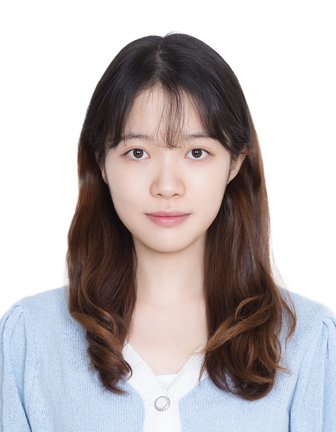
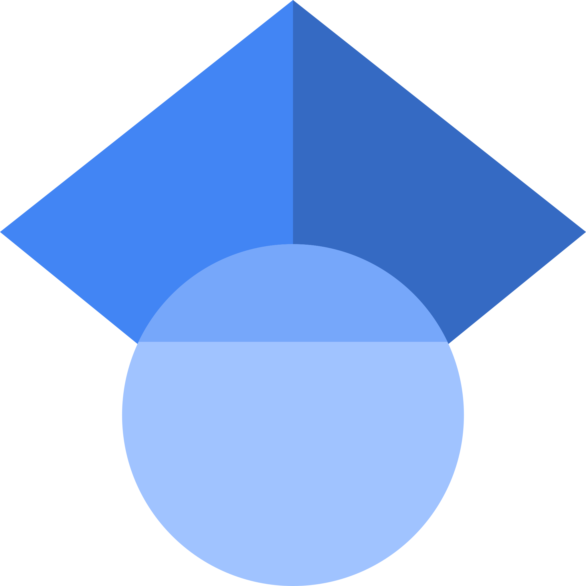

## About Me

  

  

    
    
    
    
    
  

Hi! I am a Ph.D. student at [KAIST School of Computing](https://cs.kaist.ac.kr/), advised by [Prof. Alice Oh](https://aliceoh9.github.io/).

I study **how reasoning works internally in language models and how that understanding can enable better intervention and control**. My current research focuses on **reasoning representations**, **mechanistic interpretability**, and **latent reasoning**.

Broadly, I am interested in three connected questions:

- **How does reasoning work internally?**
- **Why does reasoning succeed or fail?**
- **How can we intervene to guide, improve, and control it?**

My long-term goal is to build language models capable of increasingly sophisticated reasoning while remaining **reliable, interpretable, and controllable**, enabling people to use AI safely and confidently.

## Research

### Understanding Reasoning Beyond the Output

Much of the work on LLM reasoning focuses on the reasoning that models produce as text. I am interested in what happens **beneath the output**: how reasoning is represented internally, what distinguishes different reasoning processes, and what separates successful from failed computation.

In **Beneath the Surface of Chains-of-Thought**,<a href="#ref-1">[1]</a> we study whether different reasoning operations are distinguishable inside language models beyond what can be observed from their generated text. We find that reasoning operations exhibit distinct representation-level signatures, particularly in intermediate layers, suggesting that internal representations can reveal aspects of reasoning that are not apparent from surface-level outputs.

This motivates the direction I am pursuing now: if useful information about reasoning exists in latent representations, **can we use that information not only to understand reasoning, but also to guide and improve it?** I am particularly interested in **soft-token-based latent reasoning** and, more broadly, in model-level interventions that make reasoning more reliable and controllable.

My path toward these questions began with **behavior-level evaluation** across multilingual, cross-cultural, and localization settings.<a href="#ref-2">[2]</a><a href="#ref-3">[3]</a><a href="#ref-5">[5]</a> These projects gradually led me toward questions that behavioral evaluation alone cannot answer: **why behavioral differences emerge, how they are represented internally, and how manipulating internal representations can alter downstream behavior**.<a href="#ref-4">[4]</a><a href="#ref-6">[6]</a> This progression—from behavior to internal mechanisms and then to intervention—now shapes how I think about reasoning in language models.

## Education

- **Korea Advanced Institute of Science and Technology (KAIST)** (Sep 2026 – Present)
  - Ph.D. student in [School of Computing](https://cs.kaist.ac.kr/)
  - Advisor: [Prof. Alice Oh](https://aliceoh9.github.io/)

- **Korea Advanced Institute of Science and Technology (KAIST)** (Sep 2024 – Aug 2026)
  - M.S. in [School of Computing](https://cs.kaist.ac.kr/)
  - Advisor: [Prof. Alice Oh](https://aliceoh9.github.io/)

- **Korea Advanced Institute of Science and Technology (KAIST)** (Feb 2019 – Aug 2024)
  - B.S. in [School of Computing](https://cs.kaist.ac.kr/)
  - Minor in [Mathematical Sciences](https://mathsci.kaist.ac.kr/home/)
  - Individually Designed Major in [Electrical Engineering](https://ee.kaist.ac.kr/) and [Bio and Brain Engineering](https://bioeng.kaist.ac.kr/)

## Publications

### Conference Proceedings

**[1]** **Seogyeong Jeong**, Dongyoon Han, Jaehui Hwang, Geonmo Gu, Alice Oh, Taekyung Kim. 2026.  
[Beneath the Surface of Chains-of-Thought: A Mechanistic Interpretation of Reasoning Operations in LLMs.](https://arxiv.org/abs/2609.04753)  
*EMNLP 2026 Main Conference (Long).* [[Demo]](https://seogyeongjeong.github.io/beneath-cot-live/)

**[2]** **\*Seogyeong Jeong**, \*Kiwoong Park, Seyoung Song, Eunsu Kim, Ken E. Friedl, Jaeho Kim, Alice Oh. 2026.  
[LoCar: Localization-Aware Evaluation of In-Vehicle Assistants through Fine-Grained Sociolinguistic Control.](https://aclanthology.org/2026.acl-industry.148/)  
*ACL 2026 Industry Track.*

**[3]** \*Seyoung Song, **\*Seogyeong Jeong**, Eunsu Kim, Jiho Jin, Dongkwan Kim, Jay Shin, Alice Oh. 2025.  
[MUG-Eval: A Proxy Evaluation Framework for Multilingual Generation Capabilities in Any Language.](https://aclanthology.org/2025.findings-emnlp.1061/)  
*Findings of EMNLP 2025.* Also presented at the *5th Workshop on Multilingual Representation Learning (MRL 2025).*

### Workshop Papers

**[4]** Soyeon Park, **\*Seogyeong Jeong**, \*Sunwoo Kim, Alice Oh. 2026.  
[The Role of Fine-grained Harm Signals in LLM Safety.](https://arxiv.org/abs/2609.19366)  
*NeurIPS 2026 Workshop – Interpretability for Science.*

**[5]** \*Junyeong Park, **\*Seogyeong Jeong**, \*Seyoung Song, Yohan Lee, Alice Oh. 2025.  
[LLM-C3MOD: A Human-LLM Collaborative System for Cross-Cultural Hate Speech Moderation.](https://aclanthology.org/2025.c3nlp-1.7/)  
*NAACL 2025 Workshop – C3NLP.* [[Slides]](https://docs.google.com/presentation/d/1vrY2a9SjjJcQppSSRhxNuJyC0pyzdlxPdgk0KB6Lfp4) [[Poster]](/materials/LLM-C3MOD.pdf)

## Preprints

**[6]** Haeun Yu, Arnav Arora, **Seogyeong Jeong**, Nadav Borenstein, Siddhesh Pawar, Jisu Shin, Jiho Jin, Junho Myung, Alice Oh, Isabelle Augenstein. 2025.  
[Entangled in Representations: Mechanistic Investigation of Cultural Biases in Large Language Models.](https://arxiv.org/abs/2508.08879)  
*arXiv preprint.*

**[7]** Paul Röttger, Giuseppe Attanasio, Felix Friedrich, Janis Goldzycher, Alicia Parrish, Rishabh Bhardwaj, Chiara Di Bonaventura, Roman Eng, Gaia El Khoury Geagea, Sujata Goswami, Jieun Han, Dirk Hovy, **Seogyeong Jeong**, Paloma Jeretič, Flor Miriam Plaza-del-Arco, Donya Rooein, Patrick Schramowski, Anastassia Shaitarova, Xudong Shen, Richard Willats, Andrea Zugarini, Bertie Vidgen. 2025.  
[MSTS: A Multimodal Safety Test Suite for Vision-Language Models.](https://arxiv.org/abs/2501.10057)  
*arXiv preprint.*

*\* Indicates equal contribution.*

## Research Experience

- **[NAVER AI Lab, Backbone Team](https://naver-career.gitbook.io/en/positions/ai-ml/backbone-research)** (Mar 2026 – Sep 2026)
  - *Research Intern*
  - Investigated **internal representations of LLM reasoning**, leading to a first-author paper at **EMNLP 2026 Main Conference**.<a href="#ref-1">[1]</a>
  - Initiated ongoing research on **soft-token-based latent reasoning**.

- **[User & Information Lab](https://uilab.kr/)** (Jun 2022 – Aug 2024)
  - *Research Intern* — Graph neural networks, NLP

- **[Emerging Nano Technology and Integrated Systems Lab](https://shinhyunlab.kaist.ac.kr/)** (Jun 2021 – Feb 2022)
  - *Research Intern* — Neuromorphic computing

## Awards & Honors

- **Excellence Award (2nd Place)**, 3rd AI Hackathon for Network Intelligence, Open AI Networking Korea (ONK) 2025, hosted by [AI Network Forum](https://ainet.or.kr/) (**Top 2% among 94 teams**).

## Academic Service

- **Reviewer**, NeurIPS 2026 Workshop – Interpretability for Science
- **Reviewer**, EMNLP 2026 Industry Track
- **Emergency Reviewer**, NeurIPS 2026 Evaluations and Datasets Track

## Teaching Experience

- **Teaching Assistant**, [Introduction to Computer Programming](https://cs101.kaist.ac.kr/), KAIST (Spring & Fall 2025)

<!-- 
## Typography

This is a [link](http://google.com). Something *italics* and something **bold**.

Here is a table

Year | Award | Category
-----|-------|--------
2014 | Emmy  | Won Outstanding Lead Actor in a miniseries or a movie
2015 | BAFTA | Nominated for Best Leading Actor for Sherlock
2014 | Satellite | Won Best Actor miniseries or television film

Here is a horizontal rule

---

Here is a blockquote

> To a great mind, nothing is little

<!-- ## References

* Foo Bar: Head of Department, Placeholder Names, Lorem
* John Doe: Associate Professor, Department of Computer Science, Ipsum --> 
